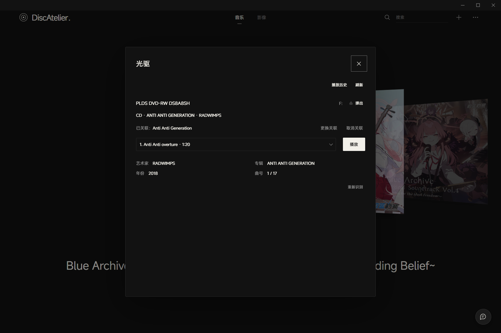
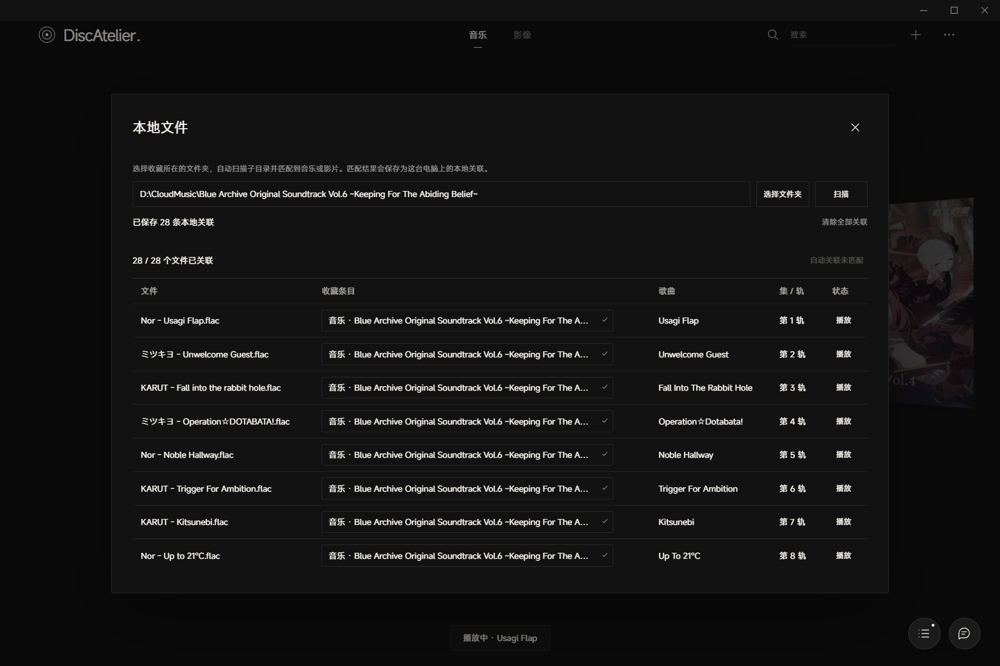
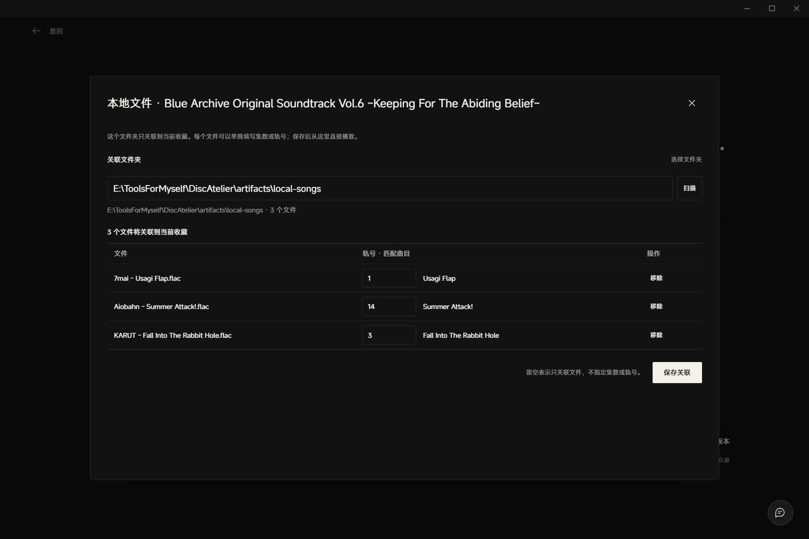
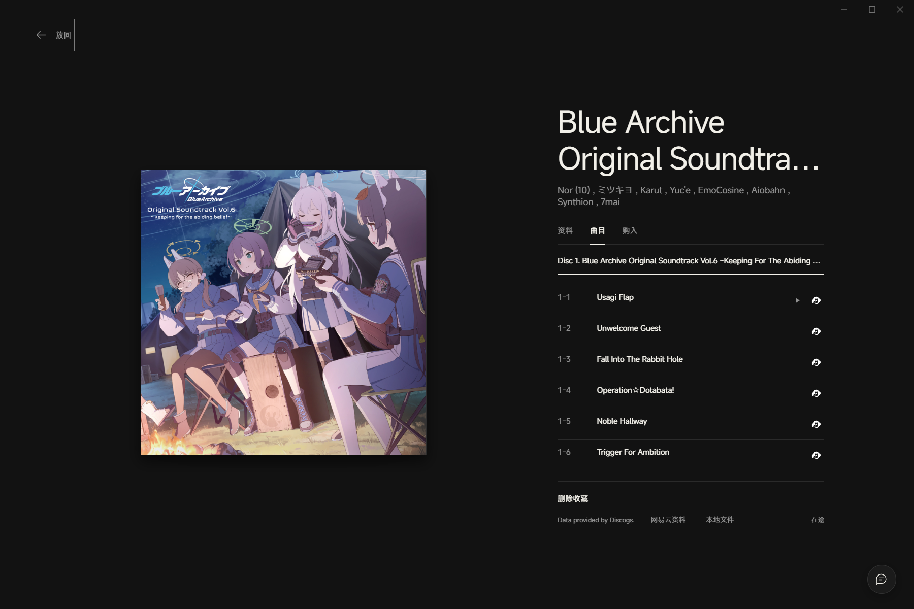
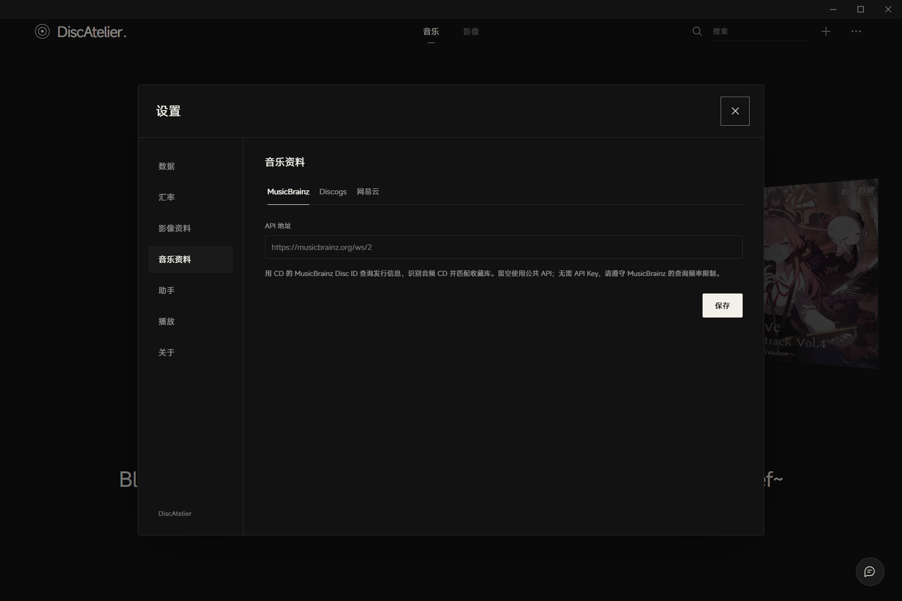
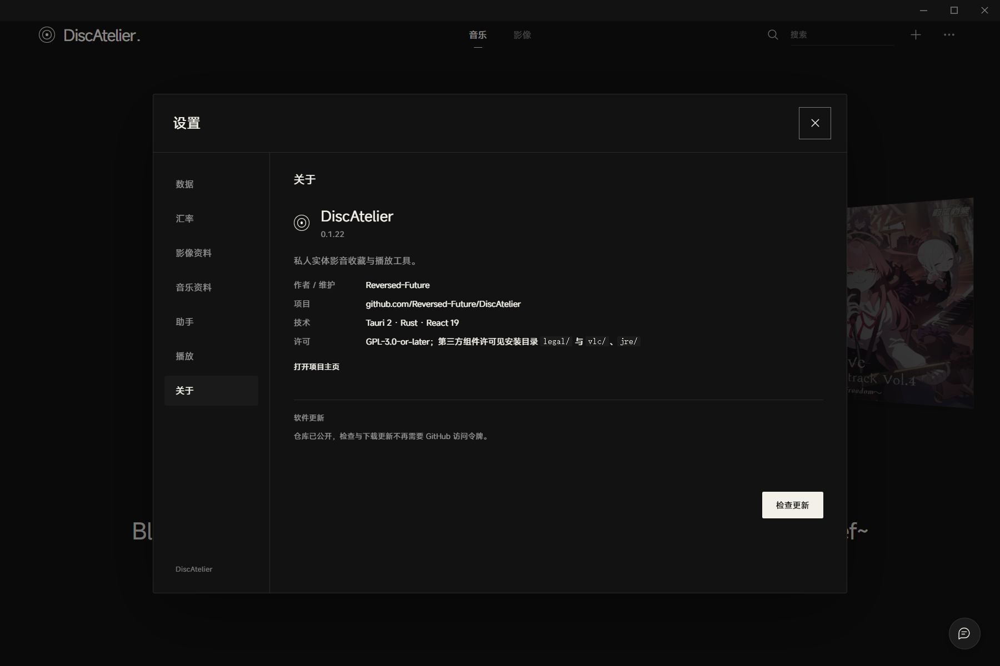
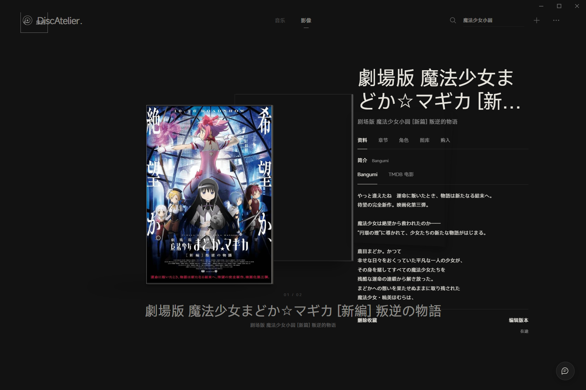
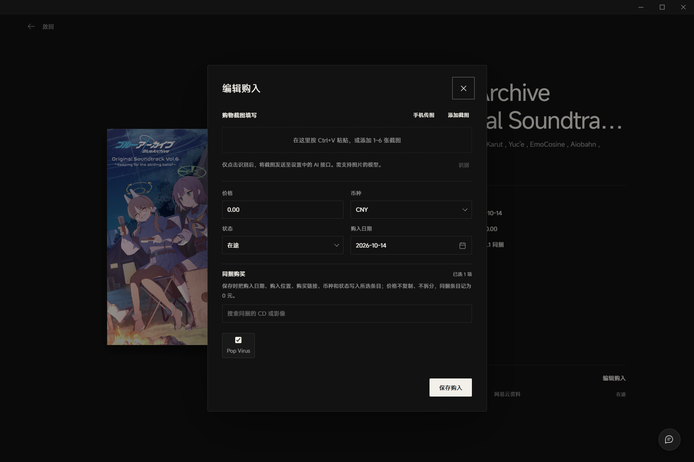

# DiscAtelier

> 把实体唱片、影碟和它们的故事，安静地放在一个地方。

DiscAtelier 是一个面向个人实体影音收藏的 Windows 桌面应用。它以**具体发行版本**和**手里的那一套实体**为核心，管理音乐与影像收藏、购入记录、封面、实体模型、光驱识别和播放历史。


## 功能

### 实体收藏，而不是一张在线歌单

- 音乐与影像分区；
- 同一版本可以有多套实体，分别记录购入价格、日期、卖家、位置和状态；
- 记录条码、品番、版本、载体、流派、风格和数字发行日期；
- 支持封面、实体模型和自定义图片；
- 收藏详情、曲目、购入信息和资料分区展示；
- 搜索、状态筛选、整理排序和同捆购入。


### 资料自动识别

- **Discogs**：条码、品番、关键词或发行 ID 可直接输入，自动判断类型，也可手动指定兜底；
- **MusicBrainz**：通过 CD 的 Disc ID 识别音频 CD，匹配收藏库；
- **网易云**：搜索专辑、读取分享链接、补充曲目和封面，也可以直接从网易云开始添加；
- **AI 资料识别**：识别实体包装、购物截图，以及实验性的光盘菜单截图；
- 识别结果始终作为候选，保存前需要人工确认。

### 光盘与播放

- 光驱只读识别 CD、DVD、Blu-ray；
- 光驱内容与收藏条目的关联、播放历史和光驱面板缓存；
- 插入已关联光盘时底部提示是否跳转；确认后滑到对应收藏，标题旁的光驱图标可打开光驱界面；
- 内置 VLC 3.0.22 和 Temurin JRE，DVD／Blu-ray 菜单不需要用户另装 VLC 或 Java；
- CD 播放器支持曲目、封面、音量、上一首／下一首；
- 视频使用 MPV／VLC 后端，支持进度、音轨、倍速、全屏和字幕；
- 播放进度平滑推进，播放器淡入淡出；
- Blu-ray 菜单和 BD-J 的运行链路已接入，但仍需真实样盘验收。



### 本地文件关联

- 选择收藏所在的文件夹后，递归扫描所有子目录；
- 根据文件夹名、标题、作者和文件名自动匹配音乐专辑或影片；
- `S01E01`、`第 01 集`、`EP01` 以及开头的 `01/02/03` 会识别为集数；
- 音乐文件的 `01 - 曲名`、`CD03`、`Track 12` 会识别为轨号；
- 没有数字前缀时，`艺人 - 歌名` 会和专辑曲目表逐首比对，自动填入正确轨号；
- 关联表会单独显示匹配到的歌曲标题，并按专辑轨号顺序排列；
- 未匹配的文件保留在关联表中，可以手动选择收藏，或使用“自动关联未匹配”；
- 保存关联后可以从关联表直接启动本地文件播放；
- 曲目列表和章节列表的每一行都有本地播放符号；网易云匹配到的曲目还显示白色网易云按钮；
- 本地音乐播放会直接叠层打开 CD 式播放界面，不需要先关闭详情；关闭后缩到右下角播放列表，可直接切歌而不用先停止；
- “更多 → 本地文件”是总入口；每个收藏详情里也有“本地文件”，只处理当前这一套，并可逐文件填写集数或轨号。

> 本地文件关联、曲目播放按钮和光驱插入提示在 0.1.23 正式版中提供。



详情页会在轨号旁显示匹配到的曲目名，未匹配时明确标出，可手动修改：



曲目行末尾提供本地播放符号和白色网易云播放按钮；章节行提供本地播放符号：



### 手机接力

- 手机与电脑同一 Wi-Fi，扫码连接；
- 条码在有效期内可以连续扫描，多个条码依次更新电脑搜索框；
- 也可以从手机发送购物截图，在电脑上确认识别；
- 局域网传输不经过云端，连接有时限，关闭窗口即结束。

### 数据与隐私

- 本地 SQLite 收藏库，数据目录可在设置中打开；
- 自动备份、备份管理和恢复前预览；
- 更新前自动备份收藏；
- AI、Discogs、网易云等密钥保存在 Windows 凭据管理器；
- 应用不访问真实收藏和光盘以外的个人文件。



### 助手与工具

- 内置 AI 助手可以查询收藏、准备修改并等待确认；
- 支持查找发行资料、补充曲目、整理收藏；
- 所有写操作都有确认和撤销边界；
- 设置页包含数据、汇率、影像资料、音乐资料、助手、播放和关于。



## 截图

| 影像资料 | 购入与同捆 |
| --- | --- |
|  |  |

## 安装

从 [GitHub Releases](https://github.com/Reversed-Future/DiscAtelier/releases) 下载最新的 Windows x64 安装包：

- 当前版本：**0.1.23**
- 安装包已内置 VLC 和 Java 运行时，不需要另外安装播放器；
- 按当前 Windows 用户安装；
- 没有 WebView2 时安装器会引导下载；
- 安装包不包含个人收藏、凭据、光盘内容或其他用户数据；
- Windows Authenticode 尚未配置，首次运行可能出现 SmartScreen 提示。

更新检查使用公开的 GitHub Release API，不再需要填写访问令牌。

## 开发

需要 Windows x64、Rust MSVC、Node.js 22.19+、Visual Studio C++ 工具和 WebView2。

```powershell
npm ci
npm run dev
```

构建预览程序（不生成安装包）：

```powershell
npm run build
npm run tauri:build
```

构建签名 NSIS 安装包需要现有的 Tauri 更新签名身份：

```powershell
$env:CARGO_TARGET_DIR = 'D:\DiscAtelierBuilds\target'
.\scripts\release\build-signed.ps1
```

`scripts/prepare-vlc.ps1` 下载并校验 VLC／Temurin 运行时；固定版本、许可证和源码地址见 [内置运行时说明](docs/BUNDLED-VLC.md)。

播放器、光驱和资料源的实现记录见 [播放开发记录](docs/PLAYBACK-DEVELOPMENT.md)、[光驱开发记录](docs/OPTICAL-DEVELOPMENT.md) 和 [集成边界](docs/INTEGRATIONS.md)。

## 数据位置

默认数据目录：

```text
%LOCALAPPDATA%\com.reversedfuture.discatelier
```

其中包括 `library.sqlite3`、`backups`、播放器设置和 WebView2 数据。本地文件关联保存在同目录的 `local-files.json`；它记录本机文件路径，不进入 SQLite 备份，迁移电脑后需要重新选择文件夹。安装目录与数据目录分离；更新不会覆盖收藏和备份。

## 项目状态

当前是 **0.1.23**，不是 1.0。

1.0 前仍需完成：

- 真实 DVD 和 Blu-ray 样盘的菜单验收；
- BD-J／Java 环境在不同光盘上的兼容性验收；
- 光盘菜单 AI 识别的真实样盘端到端验收；
- 安装、覆盖升级、应用内更新和下一版本更新的完整人工验收；
- 公开仓库后的许可证与第三方源码合规复核。

在这些项目完成前，不把菜单或 BD-J 标为“已支持”，也不宣称全区播放完成。

## 许可证

本项目以 **GNU General Public License v3.0 or later**（GPL-3.0-or-later）发布，完整文本见 [LICENSE](LICENSE)。

安装包包含的 VLC 3.0.22、Temurin JRE 8、libaacs、libbdplus 及其他第三方组件仍适用各自许可证；固定版本、校验值、许可证文件和源码地址见 [docs/BUNDLED-VLC.md](docs/BUNDLED-VLC.md) 与安装目录下的 `legal/`、`vlc/`、`jre/`。

## 作者

Reversed-Future

项目地址：<https://github.com/Reversed-Future/DiscAtelier>
