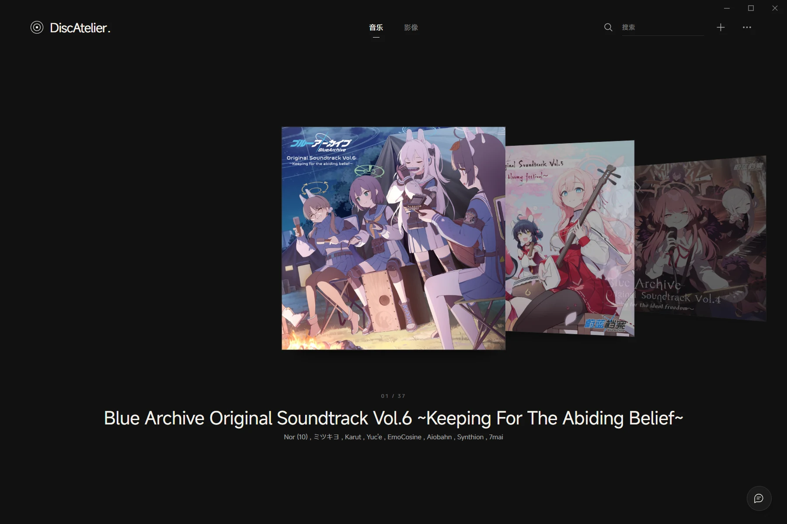
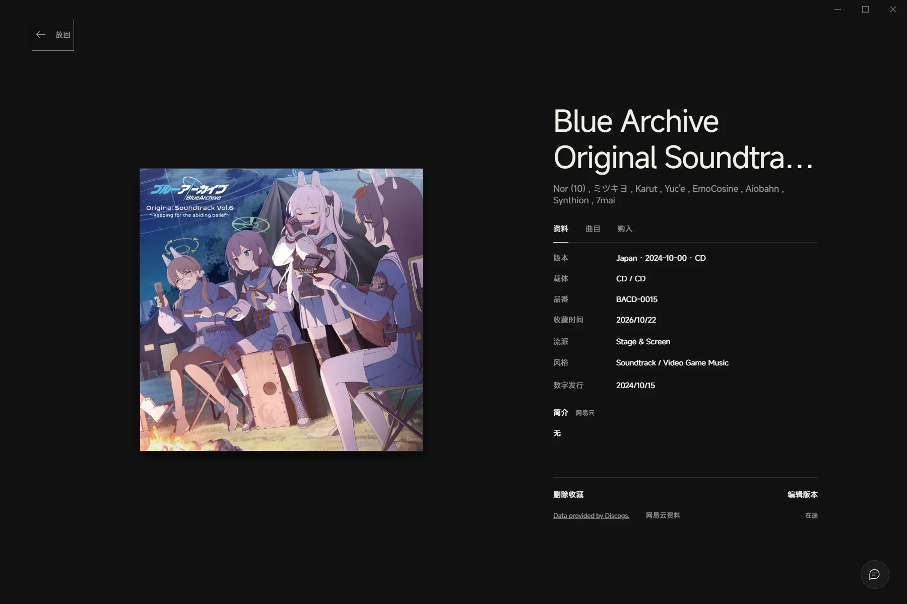
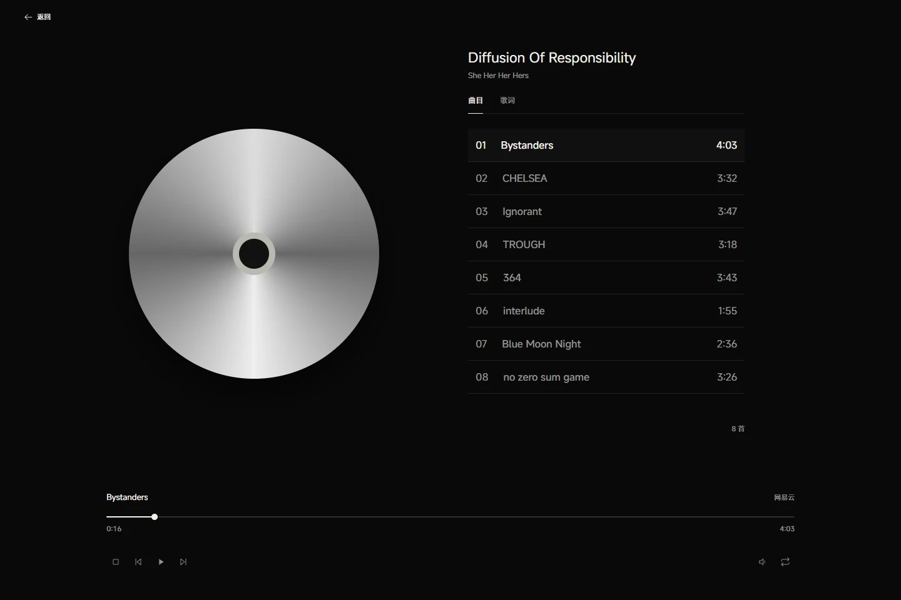
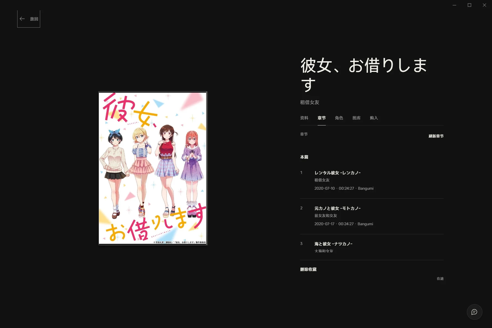

<div align="center">

# DiscAtelier.

### 让收藏，重新被看见。

唱片、影碟，还有它们背后的故事。<br>
**收藏 · 整理 · 播放**

[下载 Windows 版](https://github.com/Reversed-Future/DiscAtelier/releases/latest) · [功能一览](#功能一览) · [模型指南](https://docs.reversed-future.com/disc-atelier/models/) · [介绍视频](docs/site/assets/discatelier-introduction.mp4)

</div>



DiscAtelier 是为个人实体影音收藏而做的 Windows 桌面应用。从一张 CD 到一套 Blu-ray，把**发行版本**、**每套实体的购入记录**与**播放体验**放在一起。作品资料可以从多个来源补充，细节也能自己整理。

## 从收藏，到重温

| 收藏有自己的样子 | 音乐回到日常 |
| --- | --- |
|  |  |
| 封面陈列、列表排序、多套实体与独立购入记录。 | CD、本地音乐、网易云；曲目与歌词一键切换。 |

> 播放界面使用示例播放状态。画面中的封面与作品资料归各自权利人所有。

### 记住“哪一份”，而不只是“有”

同一专辑的不同发行、同版收藏的多套实体、一次同捆买下的作品，都有各自的位置。记录条码、品番、载体与发行信息，也记录购入价格、日期、卖家、存放位置和状态。

封面模式慢慢翻，列表模式快速找。支持拖拽排序、状态筛选，以及标题、作者、曲目和章节搜索。

### 一份实体，可以连接多份资料

- **Discogs**：从作品名、条码、品番或发行 ID 查找版本，也能在编辑时更换发行资料与封面。
- **网易云**：搜索或粘贴专辑、歌曲分享链接，直接添加收藏、补充资料和封面。一份实体支持多张专辑关联，并按 Disc 分别绑定；歌曲也能单独关联和纠错。
- **TMDB / Bangumi**：查找电影、电视与动画作品，区分作品资料和实体版本。简介保留来源切换，匹配的剧集合并图文，角色与图库统一展示。
- **自己整理**：编辑曲目、分盘、小标题、逐曲 Credits、公司、章节与角色资料。缺少数据源条目时可手动入库，或用包装图片辅助识别。



前后编来自不同作品条目，也能放进同一套实体。首页以叠放卡片呈现，翻面查看另一部分。

### 三种来源，同一种聆听

CD、本地音乐和网易云使用完整播放界面，提供进度、音量、上一首／下一首及循环控制。从本地音乐切换到网易云，成功取得音源后自动接替播放。

右下角的播放队列保留最近三个专辑，支持列表循环与单曲循环；返回收藏页，音乐继续。歌词从网易云获取，显示原文与可用译文、跟随进度并支持点击跳转；已关联的本地音乐和 CD 也可使用。在设置中开启 **Windows 媒体控制（SMTC）**，即可通过系统面板操作播放。

音乐开始、暂停与继续播放带有短暂的音量渐变。关闭窗口时可选择退出或最小化到托盘，并记住选择；托盘支持播放控制、循环切换和返回主窗口。首页右键收藏可查看、编辑、复制名称或删除，选中文字也可复制。

网易云支持扫码登录，凭据安全保存；完整音源或试听由账号权限与歌曲可用性决定。

### 光盘和本地文件，也在收藏里

识别 CD、DVD、Blu-ray 光驱载体，关联对应收藏；音频 CD 可通过 MusicBrainz Disc ID 等资料识别获取曲目信息。支持兼容光盘的菜单、章节、音轨、播放速度及全屏控制，AI 菜单识别可辅助关联并允许纠正。

从收藏详情中的 **本地文件** 入口选择文件夹，匹配曲目或章节，也能手动修正。从曲目、章节或关联表直接播放，无需重新找文件。

内置播放器运行组件。不同光驱、光盘加密和菜单格式的兼容性会影响实际可播放范围。

### 不止看封面，也能翻一翻

可导入 `.ateliermodel` 交互模型，按照模型定义打开盒盖、取放部件、翻阅书册。兼容 V2、V3、V4 模型；也支持直接导入 **GLB、OBJ、FBX、SKP**，查看材质、贴图与文件中受支持的动画，并旋转、平移、缩放和重置视角。

SKP 目前支持 SketchUp 2017 与 2026 容器中的静态几何、组件和受支持贴图。详情模型在后台加载与绘制，加载时仍可操作界面，离开详情会取消任务。

原格式模型不会自动生成拆装动作。资源要求和格式边界详见 [三维文件导入指南](https://docs.reversed-future.com/disc-atelier/models/source-models.html)。

[阅读模型指南](https://docs.reversed-future.com/disc-atelier/models/) · [下载 AI Skill](https://docs.reversed-future.com/disc-atelier/models/downloads/discatelier-model-author-skill.zip) · [下载制作入门包](https://docs.reversed-future.com/disc-atelier/models/downloads/discatelier-model-starter.zip) · [通用提示词](https://docs.reversed-future.com/disc-atelier/models/downloads/AI-PROMPTS.md)

### 少一点录入，多一点享受

**助手**以流式对话陪你聊音乐、查询收藏，准备添加、补全网易云资料、切换封面和播放操作。涉及修改收藏，先展示具体变更，等你在界面确认。

**购物截图**可粘贴或上传多张，识别价格、日期、卖家等字段并展示依据，选择需要的内容后保存。**手机**与电脑连接同一 Wi-Fi，扫码后可连续发送条码、购物截图和包装照片。

原币金额始终保留；配置汇率后，按每日更新的汇率查看参考换算与收藏汇总。

## 功能一览

| 收藏 | 播放 | 整理与工具 |
| --- | --- | --- |
| 音乐 / 影像分区 | CD / 本地音乐 / 网易云 | Discogs / 网易云 / TMDB / Bangumi |
| 封面陈列 / 列表拖拽 | 跨页队列 / 三专辑历史 | 多专辑关联 / Disc 绑定 |
| 多套实体 / 同捆购入 | 列表循环 / 单曲循环 / 音量 | 独立歌曲关联 / 匹配纠错 |
| 原名 / 译名 / 作品资料 | 歌词跟随 / 点击跳转 | 曲目 / 小标题 / 逐曲 Credits |
| 章节 / 角色 / 合并图库 | Windows 媒体控制 | AI 助手 / 包装与购物截图识别 |
| 前后编翻面 / 自选封面 | DVD / BD 菜单与章节 | 手机条码 / 图片上传 |
| 交互模型 / 三维文件导入 | 本地文件关联 / 播放历史 | 每日汇率 / 备份管理 / 应用内更新 |

## 开始使用

1. 在 [GitHub Releases](https://github.com/Reversed-Future/DiscAtelier/releases/latest) 下载 Windows x64 安装包。所需 WebView2 由安装程序引导安装。
2. 添加第一份收藏：搜索发行版本、粘贴资料链接，或手动填写。
3. 按需在设置中配置资料服务、网易云账号与 AI 服务；关联光盘或本地文件后开始播放。

启动时会检查更新，也可忽略。应用内更新会验证更新签名，并在升级前备份收藏。GitHub 服务或网络限制可能影响更新查询，可从 Release 页面手动下载。

> 安装包未配置 Windows Authenticode 签名，首次安装可能出现 SmartScreen 提示。Windows 代码签名与应用内更新签名是不同机制，请从项目官方 Release 获取安装包。

## 数据留在自己的电脑里

收藏使用本地 SQLite 保存；账号与服务凭据使用 Windows 凭据管理器。设置中可创建备份、查看占用、选择删除，以及在恢复前预览。**备份不会因发布新版本而自动清理。**

默认数据目录：

```text
%LOCALAPPDATA%\com.reversedfuture.discatelier
```

收藏备份包含收藏资料及其封面、模型资源；不包含本地音视频文件本身。本地文件关联记录在同目录的 `local-files.json`，不进入 SQLite 备份，迁移电脑后需要重新选择文件夹。

资料查询、在线播放和 AI 需要网络。AI 识别时，所选图片或相关资料会发送给你配置的服务。手机到电脑的传输在局域网完成，后续 AI 识别使用所配置的 AI 服务。

<details>
<summary><strong>开发与构建</strong></summary>

需要 Windows x64、Rust MSVC、Node.js 22.19+、Visual Studio C++ 工具和 WebView2。

```powershell
npm ci
npm run dev
```

构建桌面程序：

```powershell
npm run build
npm run desktop:build
```

运行检查：

```powershell
npm test
npm run test:rust
```

签名安装包使用项目的 Tauri 更新签名身份：

```powershell
.\scripts\release\build-signed.ps1
```

运行时准备、固定版本与许可证见 [内置运行时说明](docs/BUNDLED-VLC.md)。请勿提交令牌、Cookie、私钥、个人收藏库或购入记录。

产品网站源码在 `docs/site/`，无需构建即可预览：

```powershell
python scripts/product-launch/serve-site.py
```

模型指南源码在 `docs/model-dev/`。介绍视频的分镜、介绍稿和 MG 渲染源在 `scripts/product-launch/`；媒体成片位于 `docs/site/assets/`。

重新渲染介绍视频需要 Python 的 Pillow、NumPy、OpenCV 与 imageio-ffmpeg，无需语音合成服务：

```powershell
python scripts/product-launch/render-film.py
python scripts/product-launch/verify-film.py
```

成片为 1920 × 1080、30 fps、3 分钟，仅保留原创合成背景音与功能演示文字，不含旁白或字幕。网站提供章节跳转和独立的[介绍稿](docs/site/assets/introduction-script.md)下载。公共产品网站的 Pages 路径为 `/disc-atelier/`，模型手册保留 `/disc-atelier/models/`。发布由现有 Pages 工作流完成。

</details>

## 开源与致谢

[GPL-3.0-or-later](LICENSE) · [Reversed-Future](https://github.com/Reversed-Future)

第三方运行组件适用各自许可证，详见 [运行时与授权说明](docs/BUNDLED-VLC.md) 及安装目录中的许可文件。资料源、作品封面、角色图片与字体的权利归各自所有者。
